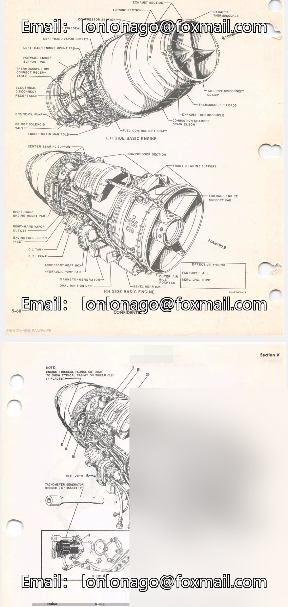
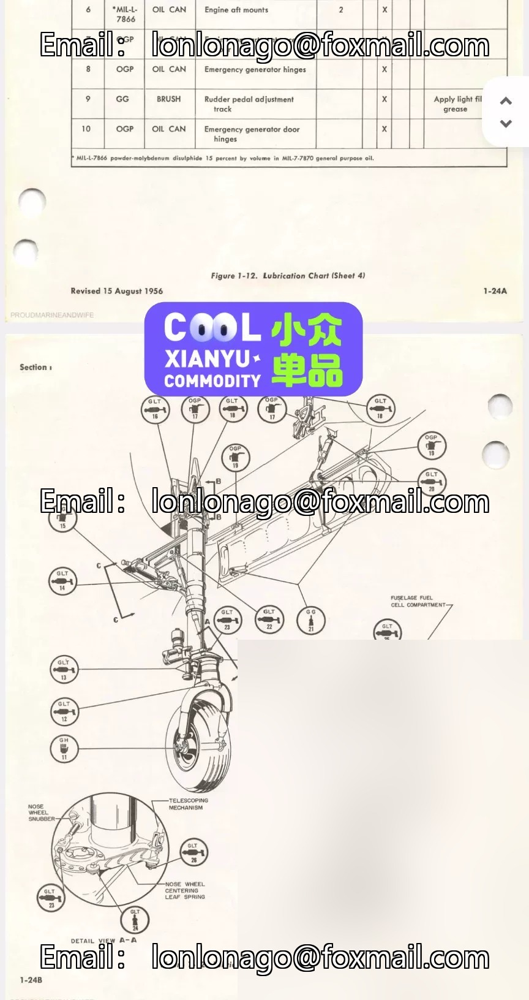
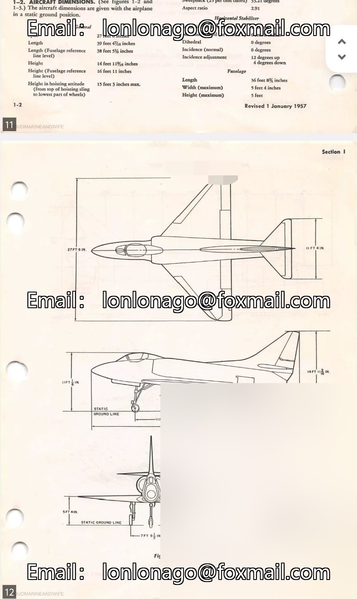
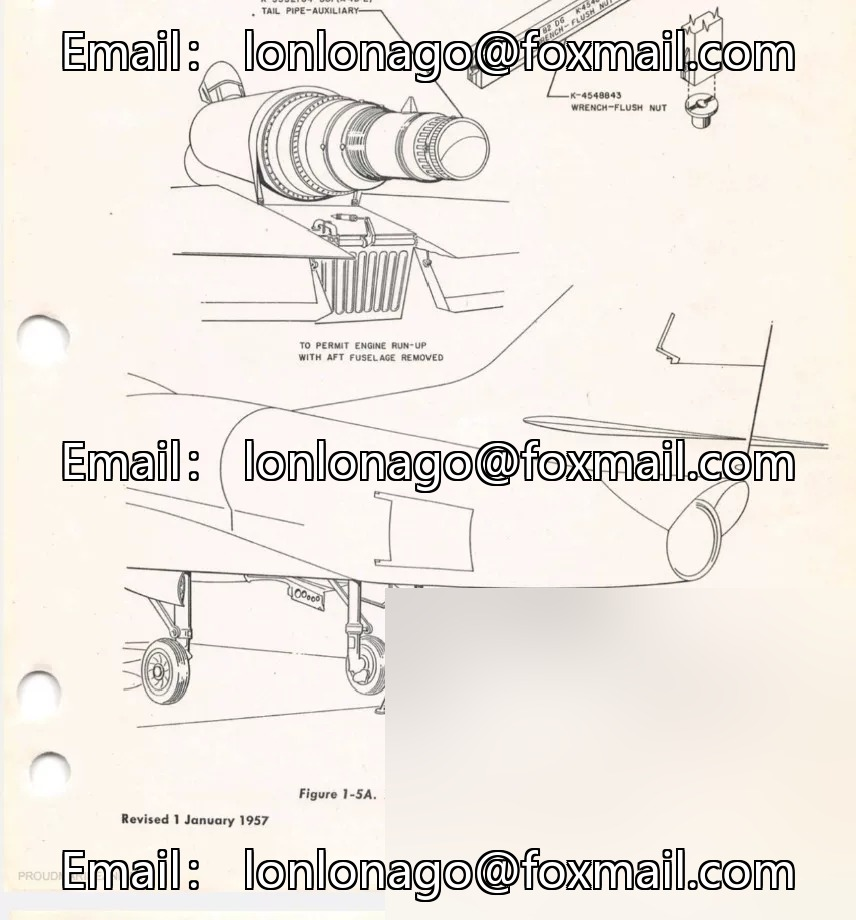
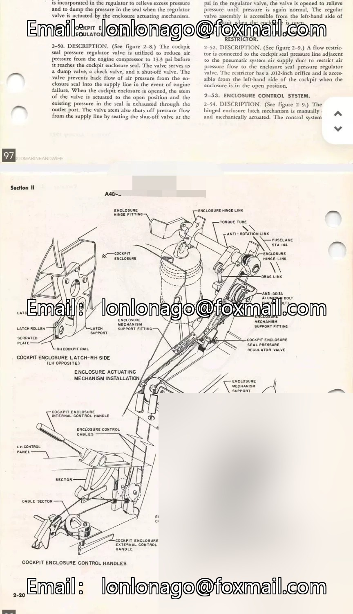

# A4D-2 BIS (A-4B "Tianying") technical manual, 842 pages, approximately

## Body

A4D-2 BIS (A-4B "Sky Eagle") technical manual, 842 pages, approximately 200 MB, .
I. Content of the materials
1. Aircraft static size data
2. Engineering drawing drawings
3. Professional parameters
II. Characteristics of the materials
1. Designed by Douglas Aircraft, a classic lightweight carrier-attack aircraft
2. Suitable for carrier dereliction planning, hangar layout, transport loading, etc.
3. Includes side view, top view, and front view, official external appearance standards
are copyable, and no exchange or return after sales.

The manual covers aircraft static size data, engineering drawing plans, and professional parameters; it features a design by the U.S. Douglas company, a lightweight carrier attack aircraft, and detailed internal components such as exhaust sections, turbine sections and engine oil pumps.

<!-- AI_ENRICHED -->

## Images

## Payment

Here is a pay link on Stripe ( https://buy.stripe.com/3cs8yP7sY87d0vu9AB ). Please contact me lonlonago@foxmail.com after funding $89, and I will send you a complete data files , thank you!

